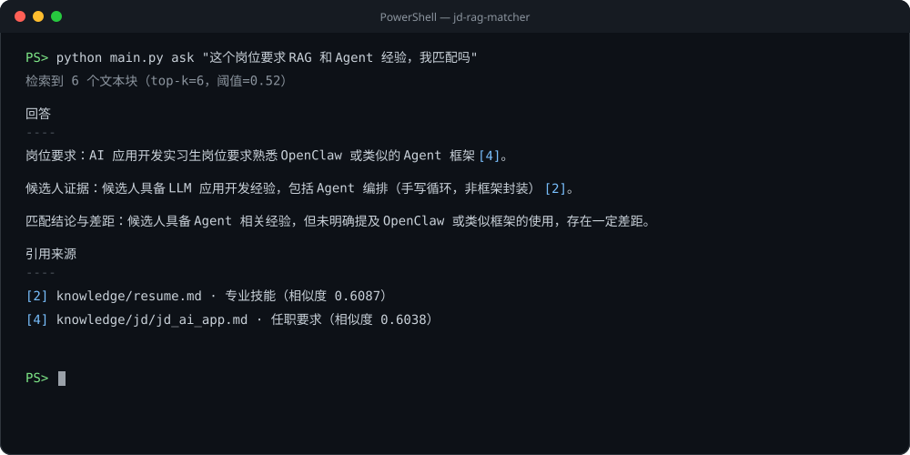
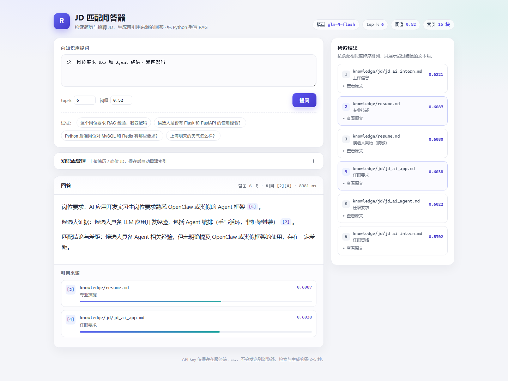

# JD 匹配问答器（RAG 小型实战）

一个不依赖 LangChain、LlamaIndex 或向量数据库的 Python RAG 命令行项目：把简历与招聘 JD 切块、向量化，检索后用 `glm-4-flash` 生成带引用来源的回答。附带一个零依赖的本地网页界面。

项目重点不是堆框架，而是把 RAG 的关键环节写清楚：切块、Embedding、余弦检索、上下文拼接、引用溯源和确定性评测。

## 演示

<p align="center">
  
</p>

上图为真实运行输出渲染的终端图，原始输出见下方代码块。

```text
$ python main.py ask "这个岗位要求 RAG 和 Agent 经验，我匹配吗"
检索到 6 个文本块（top-k=6，阈值=0.52）

回答
----
岗位要求：AI 应用开发实习生岗位要求熟悉 OpenClaw 或类似的 Agent 框架 [4]。

候选人证据：候选人具备 LLM 应用开发经验，包括 Agent 编排（手写循环，非框架封装） [2]。

匹配结论与差距：候选人具备 Agent 相关经验，但未明确提及 OpenClaw 或类似框架的使用，存在一定差距。

引用来源
----
[2] knowledge/resume.md · 专业技能（相似度 0.6087）
[4] knowledge/jd/jd_ai_app.md · 任职要求（相似度 0.6038）
```

## 功能

- 纯 Python 实现，运行依赖只有 `requests`、`numpy`、`python-dotenv`
- Markdown 按标题层级切块，TXT 按段落合并，超长文本按句子边界切分并保留重叠
- 调用 `embedding-3` 生成 1024 维向量，索引落盘为本地 JSON
- 手写余弦相似度并用 numpy 完成 top-k 检索
- 回答中的 `[n]` 由检索结果映射为具体文件与章节，不让模型自己编来源
- 10 条确定性评测，覆盖引用正确性、来源错误、编号越界和应拒答场景
- 零依赖本地网页：标准库 `http.server` + 原生 HTML/CSS/JS，不新增 pip 依赖

## 快速开始

### 环境要求

- Python 3.11+
- 智谱开放平台 API Key

### 1. 安装

```powershell
python -m venv .venv
.venv\Scripts\Activate.ps1
pip install -r requirements.txt
```

### 2. 配置

```powershell
Copy-Item .env.example .env
```

打开 `.env`，至少填写：

```dotenv
ZHIPU_API_KEY=你的_API_Key
```

其余配置可按需调整：

| 变量 | 默认值 | 说明 |
| --- | --- | --- |
| `ZHIPU_BASE_URL` | `https://open.bigmodel.cn/api/paas/v4` | OpenAI 兼容接口地址 |
| `CHAT_MODEL` | `glm-4-flash` | 对话模型 |
| `EMBEDDING_MODEL` | `embedding-3` | Embedding 模型 |
| `EMBEDDING_DIM` | `1024` | 固定维度，修改会报错 |
| `EMBED_BATCH_SIZE` | `16` | 单次向量化文本数 |
| `TOP_K` | `6` | 默认召回条数 |
| `MIN_SCORE` | `0.52` | 余弦相似度阈值 |
| `CHUNK_SIZE` | `500` | 单块最大字符数 |
| `CHUNK_OVERLAP` | `80` | 相邻块重叠字符数 |
| `MAX_TOKENS` | `800` | 回答最大 token 数 |
| `REQUEST_TIMEOUT` | `60` | 单次请求超时秒数 |

### 3. 构建索引

```powershell
python main.py build
```

索引写入 `data/index.json`。已有索引时需要显式覆盖：

```powershell
python main.py build --force
```

只检查切块、不调用接口：

```powershell
python main.py build --dry-run --show-chunks
```

### 4. 提问

```powershell
python main.py ask "这个岗位要求 RAG 经验，我匹配吗"
```

查看命中文本块与检索得分：

```powershell
python main.py ask "这个岗位要求 RAG 经验，我匹配吗" --show-context
python main.py ask "这个岗位要求 RAG 经验，我匹配吗" --top-k 6 --min-score 0.55
```

查看当前配置（Key 会脱敏）：

```powershell
python main.py config
```

### 5. 运行评测

```powershell
python eval.py
```

### 6. 交互模式（可选）

```powershell
python main.py chat
```

进入后可以连续提问，输入 `exit` 退出。每轮都会独立检索，不保留对话记忆。

### 7. 网页界面（可选）

在项目根目录执行：

```powershell
python web.py
```

打开 `http://127.0.0.1:8000`。页面支持：



- 输入问题并调整 `top-k`、相似度阈值
- 回答正文中的 `[1]`、`[2]` 可点击，定位到对应引用卡片
- 右侧展示所有召回块、相似度分数和原文
- 「知识库管理」支持上传简历与 JD，并自动重建索引

页面里的「知识库管理」可以上传自己的资料，不必手动改文件：

1. 展开「知识库管理」，点击或拖入文件
2. 简历固定保存为 `knowledge/resume.md`，JD 保存到 `knowledge/jd/`
3. 保存后自动调用 Embedding 重建索引，完成后右侧块数同步更新

上传约束：仅支持 `.md` / `.txt`，单文件不超过 200 KB，单次最多 10 个文件；JD 默认追加，勾选「清空旧文件」会先删除 `knowledge/jd/` 下的 `.md` 和 `.txt`。上传与重建接口只允许本机访问，其他设备即使能打开页面也无法写入。重建会真实调用 Embedding 接口，可能耗时数秒并消耗额度。

也可以用带参数的方式直接演示（页面自动提问）：

```text
http://127.0.0.1:8000/?q=这个岗位要求 RAG 经验，我匹配吗
```

网页只使用 Python 标准库 `http.server`，不新增任何依赖；API Key 只留在服务端 `.env`，不会出现在浏览器请求中。默认只监听 `127.0.0.1`，不要直接暴露到公网。端口被占用时可换一个：

```powershell
python web.py --port 8001
```

## 目录结构

```text
jd-rag-matcher/
├── main.py                 # CLI 入口
├── web.py                  # 本地网页与 /api/ask、/api/upload、/api/rebuild 接口
├── eval.py                 # 10 条用例的确定性评测
├── eval_cases.json         # 评测用例（问题 / 类型 / 期望来源）
├── requirements.txt
├── .env.example
├── README.md
├── docs/                   # 真实运行输出图（demo.svg、web.png）
├── web/
│   └── index.html          # 单页界面（原生 HTML/CSS/JS）
├── jdqa/
│   ├── config.py           # .env 加载、默认值与校验
│   ├── loader.py           # 文档读取
│   ├── chunker.py          # Markdown / TXT 切块
│   ├── embedder.py         # embedding-3 批量调用与重试
│   ├── store.py            # index.json 读写与校验
│   ├── retriever.py        # 手写余弦 + top-k
│   ├── generator.py        # glm-4-flash 调用与引用拼装
│   └── cli.py              # build / ask / chat 子命令
└── knowledge/
    ├── resume.md           # 脱敏简历（真实经历）
    └── jd/                 # 目标岗位 JD
        ├── jd_ai_app.md
        ├── jd_ai_intern.md
        └── jd_ai_agent.md
```

`data/`、`.env`、虚拟环境、`*.pdf` 与 `private/` 均已加入 `.gitignore`。

## 设计取舍

### 1. 切块策略：按结构切，而不是按固定长度硬切

Markdown 先按标题层级生成章节路径，例如 `项目经历 > JD 匹配问答器`；仍然超长的章节再按句子边界切分，并保留 80 字重叠。TXT 则先按空行分段，再合并到接近 500 字。

这样做的好处是每个块仍然带有语义边界，检索结果能定位到具体章节，而不是从句子中间截断。代价是块长度不完全均匀，且标题层级依赖文档本身的结构。

### 2. 为什么手写余弦，而不用向量库

数据规模只有几十个块，暴力计算完全够用：

```text
cos(q, d) = dot(q, d) / (||q|| * ||d||)
```

代码里用 numpy 一次矩阵运算完成所有块的打分，再按得分降序取 top-k。这样没有隐藏行为，能直接解释向量检索的底层原理，也避免为一个小项目引入向量数据库。

代价是每次查询都是 O(n)，不适合大规模语料。如果后续扩展到数万块，应换成近似最近邻索引，并考虑 BM25 混合检索与重排。

### 3. 引用如何保证可追溯

检索结果先按 `[1]…[k]` 编号，连同来源文件与章节一起拼进提示词，并要求模型在关键结论后标注编号。最终输出的「引用来源」列表由本地检索结果映射生成，不采用模型返回的来源文本。

评测会检查三件事：回答是否含引用、编号是否越界、引用来源是否命中期望文件。这样能发现“模型引用了不存在的块”或“引用了错误文件”，但不能完全阻止模型把编号贴到错误结论上，仍需要人工复核失败用例。生成阶段还会做一次兜底：如果回答没有引用且不是拒答，会带上提醒重试一次。

### 4. 网页为什么用标准库而不是 Web 框架

`web.py` 只负责把同一套检索与生成链路包成本地演示页：基于标准库 `http.server` 提供静态页面和 `/api/ask`、`/api/upload`、`/api/rebuild`，不新增任何 pip 依赖。它不在核心链路中，删掉 `web.py` 后 `main.py` 与 `eval.py` 仍可独立运行。这样既控制住了依赖，也避免演示层和 RAG 逻辑耦合。

## 阈值校准

`MIN_SCORE` 不能凭感觉设置。校准方法是：准备 3 个明显相关的问题和 3 个明显无关的问题，用真实的提问方式各跑一次 `ask --show-context --min-score 0`，记录每次的最高相似度。

| 类型 | 问题 | 最高相似度 |
| --- | --- | --- |
| 相关 | 这个岗位要求 RAG 和 Agent 经验，我匹配吗 | 0.6431 |
| 相关 | 候选人是否有 FastAPI 和 Python 后端经验？ | 0.6338 |
| 相关 | AI 应用开发实习岗位需要哪些能力？ | 0.7433 |
| 无关 | 公司今年年终奖发几个月？ | 0.4904 |
| 无关 | 上海明天的天气怎么样？ | 0.3827 |
| 无关 | 请推荐一部好看的科幻电影。 | 0.3543 |

无关问题最高为 `0.4904`，而评测用例需要的最低相关块为 `0.5673`，因此阈值取两者之间的 `0.52`。`TOP_K` 保持 `6`，是为了在一次匹配回答里同时容纳简历技能与多份 JD 的要求；再少会漏掉部分岗位信息。

以上得分来自当前知识库和 `embedding-3`；替换简历或 JD 后需要重新校准。

## 评测结果

评测用例共 10 条：8 条可回答，2 条应拒答。判定规则不评价文风，只检查可验证的事实：

- 可回答：回答至少含 1 个 `[n]`；编号都在本次检索结果范围内；引用来源包含期望文件
- 应拒答：检索为空，或回答明确说明知识库无依据且不产生引用

| 指标 | 结果 |
| --- | --- |
| 用例数 | 10 |
| 可回答 | 8 |
| 应拒答 | 2 |
| 通过率 | 10/10（100.0%） |

最近一次运行时间为 2026-10-21。评测会真实调用 Embedding 与对话接口，模型输出存在一定随机性；如果重跑时个别用例失败，会归因为检索未命中、引用编号越界、引用来源错误或该拒答未拒答，并人工复核，不通过修改判定逻辑来刷分。

## 已知限制

- 索引是全量暴力检索，适合几十到几千个块，不适合大规模语料
- 网页是单用户本地服务，没有登录、限流和多会话隔离，不要直接暴露到公网
- 交互模式每轮独立检索，不包含对话记忆、重排、混合检索或查询改写
- 网页上传仅支持 `.md` / `.txt` 文本，不解析 PDF、Word 等格式
- 引用编号的正确性依赖模型，评测只能发现问题，不能完全避免
- 当前知识库是脱敏后的真实简历与真实 JD（公司名、联系方式已省略），替换后仍需重新构建索引并校准阈值

## 隐私说明

仓库中的简历来自真实经历，但已去掉姓名、学校、电话、邮箱、GitHub 等身份信息；JD 去掉了公司名与联系方式。简历 PDF 原件与 `private/` 目录不会提交。`.env` 与 `data/` 也不会提交到 Git。

## 常见问题

| 现象 | 处理方式 |
| --- | --- |
| `未找到 ZHIPU_API_KEY` | 复制 `.env.example` 为 `.env` 并填写 Key |
| `索引不存在` | 先运行 `python main.py build` |
| `HTTP 401` | 检查 Key 是否有效、是否有多余空格 |
| `知识库中没有找到足够相关的依据` | 换更具体的问题，或检查 `MIN_SCORE` 是否过高 |
| 修改知识库后回答没变化 | 运行 `python main.py build --force` 重建索引 |
| `python web.py` 端口被占用 | 换端口：`python web.py --port 8001` |
